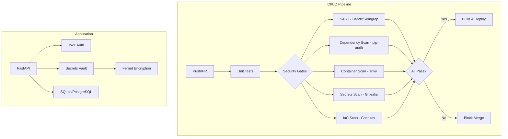

# SecurePipeline 🔒

A DevSecOps demonstration project: a Python FastAPI microservice with JWT authentication and an encrypted secrets vault, secured by a comprehensive CI/CD pipeline with 7 layers of automated security scanning.

> **Learning Project**: Each phase was added incrementally via separate PRs, documenting findings and fixes. Follow the commit history to see the DevSecOps journey from zero to production-grade pipeline.

---

## Architecture



## Quick Start

```bash
# Clone and run (< 2 minutes)
git clone https://github.com/YOUR_USERNAME/SecurePipeline.git
cd SecurePipeline

# Option 1: Docker (recommended)
docker-compose up --build
# App available at http://localhost:8000
# API docs at http://localhost:8000/docs

# Option 2: Local
python -m venv venv && source venv/bin/activate
pip install -r requirements.txt
uvicorn backend.app.main:app --reload
```

## API Endpoints

| Method | Endpoint | Description | Auth |
|--------|----------|-------------|------|
| GET | `/health` | Health check | No |
| POST | `/api/auth/register` | Register user | No |
| POST | `/api/auth/login` | Get JWT token | No |
| POST | `/api/vault/secrets` | Create secret | Yes |
| GET | `/api/vault/secrets` | List secrets | Yes |
| GET | `/api/vault/secrets/{id}` | Get decrypted secret | Yes |
| PUT | `/api/vault/secrets/{id}` | Update secret | Yes |
| DELETE | `/api/vault/secrets/{id}` | Delete secret | Yes |

## DevSecOps Pipeline Layers

| # | Layer | Tool | What It Catches |
|---|-------|------|-----------------|
| 1 | SAST | Bandit, Semgrep | SQL injection, hardcoded passwords, insecure functions |
| 2 | Linting | Ruff (S rules) | Security anti-patterns, bugs |
| 3 | Dependencies | pip-audit, Dependabot | Known CVEs in packages |
| 4 | Containers | Trivy, Hadolint | OS vulns, Dockerfile misconfigs |
| 5 | Secrets | Gitleaks | API keys, passwords in code/history |
| 6 | DAST | OWASP ZAP | Runtime vulns (XSS, auth bypass) |
| 7 | IaC | Checkov | Infrastructure misconfigurations |

## Project Structure

```
SecurePipeline/
├── .github/workflows/     # CI/CD pipelines
│   ├── ci.yml             # Tests + lint
│   ├── sast.yml           # Static analysis
│   ├── dependency-scan.yml
│   ├── container-security.yml
│   ├── secrets-scan.yml
│   └── dast.yml
├── backend/
│   ├── app/
│   │   ├── main.py        # FastAPI application
│   │   ├── config.py      # Settings management
│   │   ├── database.py    # Async SQLAlchemy
│   │   ├── routes/        # API endpoints
│   │   ├── models/        # DB models + Pydantic schemas
│   │   ├── services/      # Auth, crypto, business logic
│   │   └── middleware/    # Security headers
│   └── tests/             # Pytest suite (≥80% coverage)
├── docs/                  # Architecture & findings
├── Dockerfile             # Multi-stage, non-root, hardened
├── docker-compose.yml     # Security options enabled
├── SECURITY.md            # Vulnerability disclosure policy
└── requirements.txt
```

## Security Features (Application Level)

- **JWT Authentication** with configurable expiry
- **Fernet encryption** (AES-128-CBC) for stored secrets
- **Security headers** middleware (HSTS, CSP, X-Frame-Options)
- **Input validation** via Pydantic with strict field constraints
- **Non-root Docker** container with read-only filesystem
- **No secrets in code** — all config via environment variables

## Running Tests

```bash
pytest backend/tests/ -v --cov=backend --cov-report=term-missing
```

## What I Learned

Each phase of this project taught me a specific DevSecOps concept:

1. **Phase 1**: Secure coding fundamentals — proper auth, encryption, input validation
2. **Phase 2**: SAST catches bugs before runtime — Bandit found insecure defaults I missed
3. **Phase 3**: Supply chain attacks are real — pip-audit caught CVEs in transitive deps
4. **Phase 4**: Container security is more than just Docker — non-root, read-only FS, minimal base
5. **Phase 5**: Secrets leak easily — Gitleaks caught test credentials I forgot to remove
6. **Phase 6**: DAST finds what SAST can't — runtime auth bypass that static analysis missed
7. **Phase 7**: Infrastructure misconfigs are the #1 cloud breach vector

## Tech Stack

- **Language**: Python 3.12
- **Framework**: FastAPI + Uvicorn
- **Database**: SQLAlchemy (async) + SQLite
- **Auth**: python-jose (JWT) + passlib (bcrypt)
- **Encryption**: cryptography (Fernet)
- **Testing**: pytest + pytest-asyncio + pytest-cov
- **CI/CD**: GitHub Actions

## License

MIT — see [LICENSE](LICENSE)
